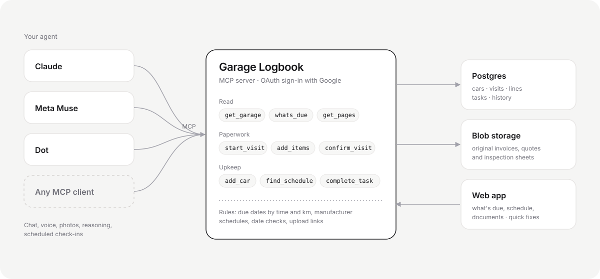

# Garage Logbook

Car maintenance with your own AI agent as the interface. You talk to Claude, Meta Muse or any other MCP client; it reads your shop paperwork, sorts out what was done, found and quoted, tells you what's really needed and what looks like an upsell, and keeps track of what's due. This app is the storage and the harness: your data, your original documents, and the rules for keeping them right.

Live: https://garage-logbook.vercel.app (signed out, it shows a sample garage).

## How it fits together

Tools: `get_garage`, `whats_due`, `add_car`, `update_car`, `delete_car`, `find_schedule`, `list_suggestions`, `track_suggestions`, `start_visit`, `upload_link`, `get_visit`, `get_pages`, `add_items`, `update_item`, `delete_item`, `update_visit`, `confirm_visit`, `delete_visit`, `create_task`, `update_task`, `delete_task`, `complete_task`, `log_work`, `set_odometer`, `search_history`.

- **Shop paperwork.** One visit often mixes an invoice, inspection notes handwritten under its lines, and a quote. The agent starts a visit and gives you a one-tap upload link, so the originals land in your storage; it then reads the pages (`get_pages` returns them as images) and records every line as done, found or quoted, in plain English next to the original wording. What you heard at the counter overrides the paperwork.
- **What's due.** `whats_due` is plain code, no model: late and upcoming tasks, quotes waiting on a decision, your own notes, a stale odometer, unfinished visits, and seasonal deadlines. An agent that can run on a schedule calls it and only speaks up when there's something to say.
- **Several cars.** Every record belongs to a car and every tool call names one; nothing on the server tracks a "current car", so a conversation can move between cars freely.
- **Dates.** Quebec paperwork often puts a two-digit year first ("26 Nov 10" is 2026-11-10). The guidance tells agents so, and the server refuses work dates in the future or before the car's model year, with a hint to read the date again.
- **Sign-in.** OAuth 2.1 for agents (client ID metadata documents, with dynamic registration as a fallback) on top of Google sign-in, via Better Auth's MCP plugin. Each agent is approved once on a consent screen. Upload links are signed, expire after an hour and only add pages to one visit.

## Connect an agent

- Claude (web, desktop, phone): Settings → Connectors → Add custom connector → `https://garage-logbook.vercel.app/api/mcp`.
- Claude Code: `claude mcp add --transport http garage https://garage-logbook.vercel.app/api/mcp`, then `/mcp` to sign in.
- Meta Muse: add `https://garage-logbook.vercel.app/api/mcp` as a remote MCP server, then sign in with Google and allow.
- Any other MCP client: add the same address as a remote (Streamable HTTP) server; it signs in with OAuth.

## Stack

Next.js 16 (App Router) on Vercel · TypeScript · Postgres on Neon · Vercel Blob · Better Auth (Google, OAuth provider, MCP) · MCP TypeScript server SDK · Claude Opus 5.5 with web search for manufacturer schedules.

## Code map

- `src/server/mcp/` MCP server, car tools, guidance for agents
- `src/server/agent/tools.ts` the visit, item, task and history tools with their validation
- `src/server/due.ts` what needs attention
- `src/server/garage.ts`, `src/server/tables.ts`, `db/schema.sql` storage
- `src/app/up/[token]` upload links; `src/app/sign-in`, `src/app/consent` the agent sign-in flow
- `src/components/GarageView.tsx`, `src/components/Edit.tsx` the web app and its quick edits
- `docs/agent-first.md` the design and why

## Run locally

Needs a Postgres `DATABASE_URL`, `BETTER_AUTH_SECRET`, `BETTER_AUTH_URL`, Google OAuth credentials, `BLOB_READ_WRITE_TOKEN` and `ANTHROPIC_API_KEY` (for schedule lookups) in `.env.local`. Then `npm run db:migrate` and `npm run dev`.
